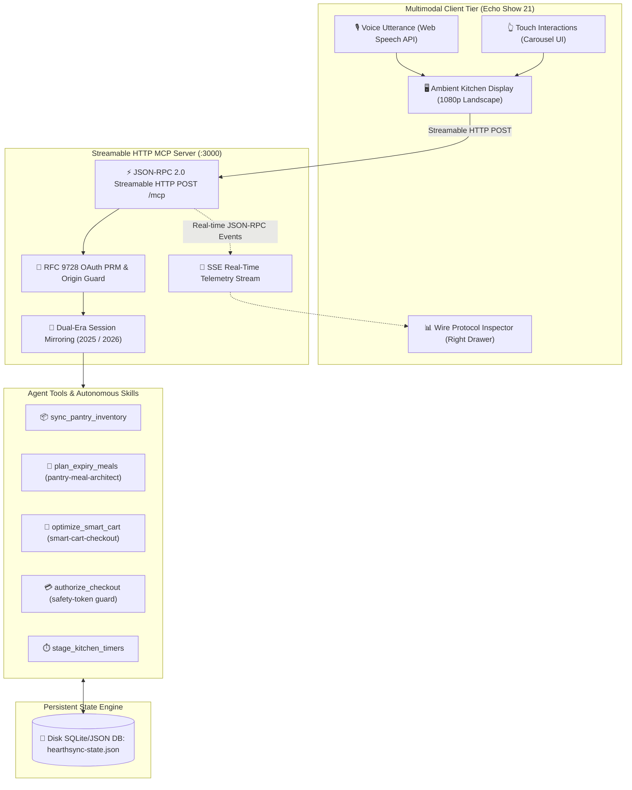

# HearthSync+ 🍳🛒

> **Autonomous Multimodal Household & Smart-Kitchen Commerce Concierge on Alexa+**  
> Built for the *Build, Ship, Shape: Amazon Developer Hackathon (Alexa+ Track & Open Source Mini-Challenge)*

[](https://opensource.org/licenses/MIT)
[](https://nodejs.org/)
[](https://www.typescriptlang.org/)
[](https://modelcontextprotocol.io/)
[](https://developer.amazon.com/alexa)

---

## 🌟 Overview

**HearthSync+** transforms Amazon Echo Show devices (featuring a native 1080p landscape canvas for the Echo Show 21) into an autonomous household sous-chef and intelligent grocery manager. 

Unlike conventional voice assistants that only answer simple commands or add raw text to an unorganized checklist, HearthSync+ acts as an agentic partner:
1. **Tracks Expiring Pantry Inventory:** Proactively detects perishables (e.g., spinach, paneer, Greek yogurt) approaching expiration dates.
2. **Plans Waste-Reducing Dinners:** Cross-references dietary requirements (nut-free, vegetarian, macro goals) to generate balanced recipes using what you already own.
3. **Optimizes Smart Carts via 4-Tier Diffing:** Compares missing ingredients against household inventory, checks for allergens, searches unit-price savings, and prepares an interactive grocery cart.
4. **Interactive MCP App (`ui://hearth/cart-carousel`):** Renders a tactile, glassmorphic carousel directly on the Echo Show screen where users can swap ingredients, adjust portions, and authorize checkout.
5. **Guardrailed 2-Step Financial Checkout:** Mandates explicit voice confirmation and spending limits before placing any order.
6. **Multi-Timer Cooking Orchestration:** Automatically coordinates staggered timers for simultaneous dishes with speech synthesizer alarms.

---

## 🏛️ System Architecture



---

## 📂 Project Structure

```text
HearthSync+/
├── .agents/                                # Agent Skills (Alexa+ Open Source Mini-Challenge)
│   └── skills/
│       ├── pantry-meal-architect/          # Meal planning skill (<2 sentences voice limit)
│       │   ├── references/                 # Big-9 allergen & macro substitution matrix
│       │   └── SKILL.md                    # Procedural instructions & constraints
│       ├── smart-cart-checkout/            # 4-stage smart cart & financial checkout skill
│       │   ├── scripts/                    # Unit-normalized price optimizer (Python)
│       │   └── SKILL.md                    # Verification tokens & error-recovery table
│       └── alexa-addon-packager/           # Addon introspection & packaging skill
│           ├── references/                 # Official alexa-addon-schema.json
│           ├── scripts/                    # Python introspection script (server -> addon.json)
│           └── SKILL.md                    # Verification instructions
├── addon-package/                          # Generated Alexa+ Distribution Package
│   └── addon.json                          # Declarative addon manifest with tool bindings
├── public/                                 # Echo Show 21 Multimodal Simulator
│   ├── app.js                              # Voice I/O, MCP HTTP Client, Audio synthesis
│   ├── index.html                          # Split-screen: Ambient UI (70%) + Inspector (30%)
│   └── styles.css                          # Alexa cyan dark mode, glassmorphism, animations
├── server/                                 # Backend Streamable HTTP MCP Server
│   ├── db.ts                               # Seeded disk-persisted state engine
│   ├── mcp-auth.ts                         # RFC 9728 OAuth 2.1 PRM & Origin Guards
│   ├── mcp-server.ts                       # Dual-era Streamable HTTP MCP server (:3000)
│   └── types.ts                            # Strict TypeScript schemas & JSON-RPC contracts
├── FRICTION_LOGS.md                        # 5 developer friction logs (+10% hackathon bonus)
├── ROADMAP.md                              # 17-step bottom-up implementation blueprint
├── package.json                            # ESM scripts, TypeScript, MCP SDK dependencies
├── tsconfig.json                           # NodeNext strict TypeScript configuration
└── .gitignore                              # Clean repository exclusion rules
```

---

## ⚡ Quick Start

### 1. Prerequisites
- **Node.js**: v18.0.0 or higher
- **Python**: v3.10 or higher (for price optimizer & addon packaging scripts)

### 2. Installation
```powershell
# Clone the repository
git clone https://github.com/ayush2singh/HearthSync-.git
cd HearthSync+

# Install Node dependencies
npm install
```

### 3. Run Automated Validations & Tests
Verify both the TypeScript builds, Python unit tests, and Alexa+ Addon schema:
```powershell
# 1. Type-check TypeScript
npm run build

# 2. Test the unit-normalized price optimizer (Python)
python -m unittest .agents/skills/smart-cart-checkout/scripts/optimize_unit_price.py

# 3. Validate the Alexa+ addon manifest schema
npm run validate:skills
```

### 4. Start the Application
```powershell
npm start
```
The server will boot in one unified daemon:
- **Echo Show 21 Simulator:** [http://localhost:3000](http://localhost:3000)
- **Streamable HTTP MCP Endpoint:** [http://localhost:3000/mcp](http://localhost:3000/mcp)
- **RFC 9728 OAuth Discovery:** [http://localhost:3000/.well-known/oauth-protected-resource](http://localhost:3000/.well-known/oauth-protected-resource)

---

## 🧪 Interactive Testing Walkthrough

Open **[http://localhost:3000](http://localhost:3000)** in any modern web browser to access the Echo Show 21 simulator.

### Workflow A: Voice-First Expiring Meal Planning
1. Click the **🎙️ Cyan Orb** (or click the quick-action button: **"🥬 Plan Dinners with Expiring Items"**).
2. Say or trigger: *"Plan dinner with expiring items"*.
3. **Result:**
   - The assistant speaks a brief summary within the strict **≤2 sentences voice limit**.
   - Displays 2 responsive recipe cards: **Palak Paneer** (using Spinach expiring in 1 day & Paneer expiring in 2 days) and **Greek Yogurt Berry Parfait** (using Yogurt expiring in 2 days).
   - The **Wire Protocol Inspector** on the right logs the exact `tools/call` for `plan_expiry_meals`.

### Workflow B: Smart Cart Diffing & Interactive Carousel
1. Click **"🛒 Stage Smart Cart"**.
2. **Result:**
   - The 4-tier substitution engine analyzes recipe needs vs. existing pantry stock, detects any missing items (e.g., Basmati Rice, Cumin Seeds, Mixed Berries), checks dietary constraints, and minimizes cart cost.
   - Dynamically mounts the rich **MCP App** (`ui://hearth/cart-carousel`) inside an isolated, secure iframe.
   - Shows live unit pricing (`$0.19/oz` vs `$0.32/oz`), badges for verified allergens, and cart subtotal ($24.89).

### Workflow C: Guardrailed Checkout
1. Click **"💳 Authorize Checkout ($24.89)"**.
2. **Result:**
   - Evaluates the $65.00 weekly household budget threshold.
   - Requires explicit approval and generates an immutable order receipt (`ORD-XXXXX`).
   - Updates the live budget gauge in the persistent database.

### Workflow D: Multi-Timer Countdown
1. Click **"⏱️ Start Paneer Simmer (12m)"**.
2. **Result:**
   - Spawns a real-time countdown timer in the ambient widget bar.
   - When finished, triggers an auditory Web Audio chime and speech announcement.

---

## 🛠️ Direct API Testing via cURL

You can interact directly with the MCP server using raw JSON-RPC 2.0 requests:

```powershell
# Call the meal planner tool directly
curl.exe -X POST http://localhost:3000/mcp `
  -H "Content-Type: application/json" `
  -d '{\"jsonrpc\":\"2.0\",\"id\":1,\"method\":\"tools/call\",\"params\":{\"name\":\"plan_expiry_meals\",\"arguments\":{\"urgencyDays\":3}}}'
```

---

## 🏆 Hackathon Alignment

| Criteria | HearthSync+ Implementation |
|---|---|
| **Streamable HTTP MCP** | Full implementation of `POST /mcp` with dual-era session tracking (`mcp-session-id` and 2026 header mirroring), SSE event logs, and RFC 9728 OAuth 2.1 discovery. |
| **Agent Skills & Multi-Step Workflows** | 3 modular skills (`pantry-meal-architect`, `smart-cart-checkout`, `alexa-addon-packager`) with explicit voice length constraints, allergen matrices, and Python optimization utilities. |
| **Multimodal UX (Echo Show 21)** | High-fidelity 1080p ambient UI featuring voice synthesis/recognition, live countdown timers, and interactive MCP App carousel embeds via secure iframes. |
| **Open Source Mini-Challenge** | Fully compliant `addon-package/addon.json` generated and validated against official schemas using auto-introspection scripts. |
| **Developer Friction Logs** | 5 comprehensive friction logs documented in [`FRICTION_LOGS.md`](./FRICTION_LOGS.md) covering SDK streaming headers, DNS rebinding, and schema nuances (+10% judging bonus). |

---

## 📄 License

This project is licensed under the MIT License — see the [LICENSE](LICENSE) file for details. Built with ❤️ for the Amazon Developer Community.
